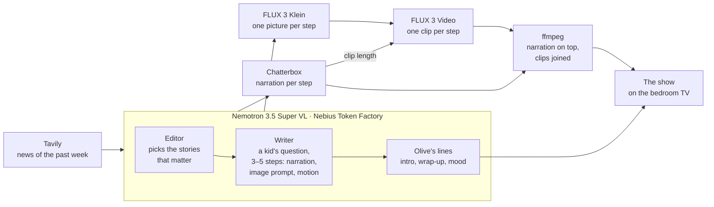
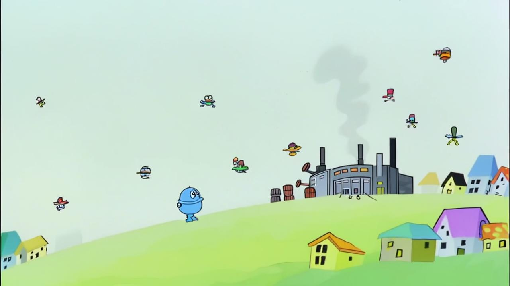
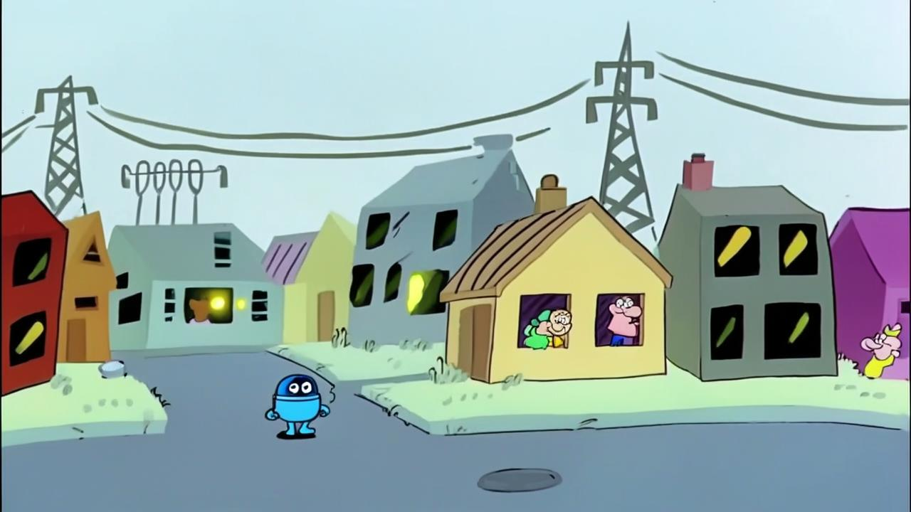
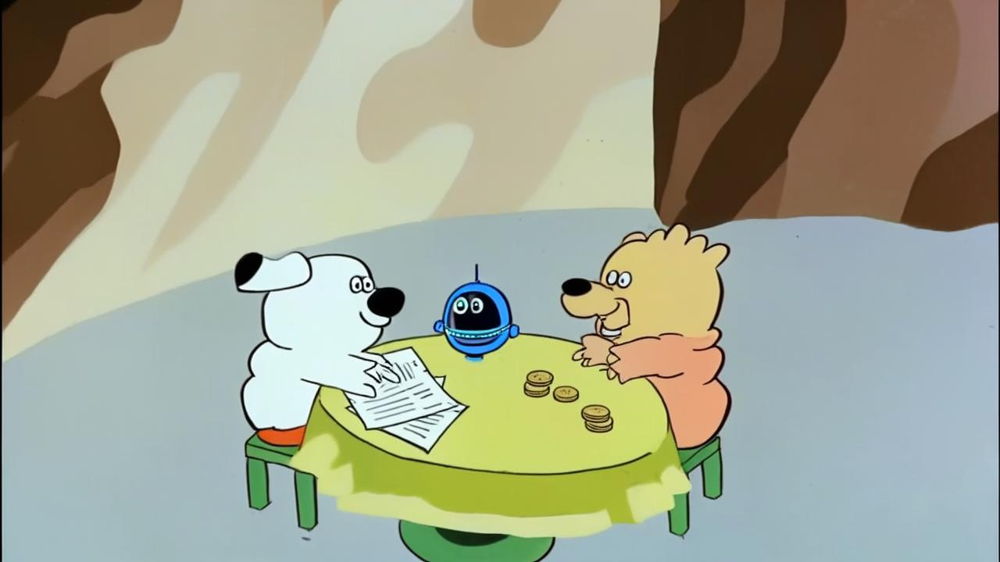
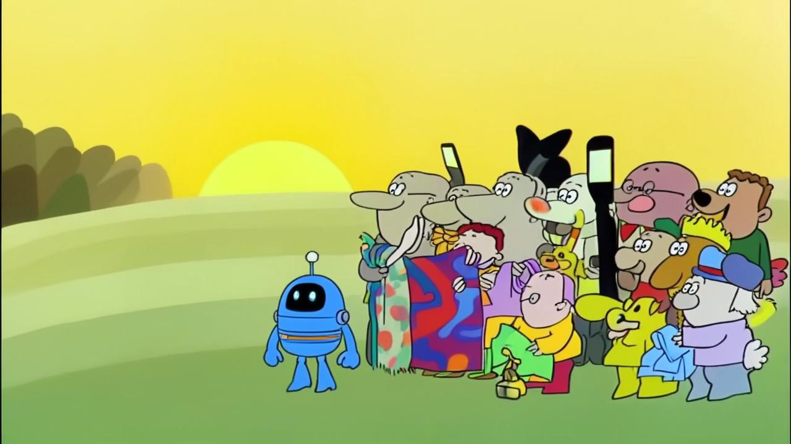
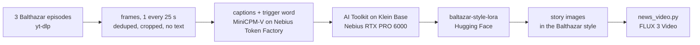
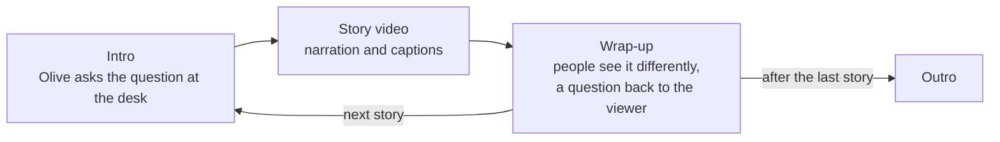

# 

Little Big Questions helps kids make sense of the big, sometimes scary things happening in the world. We take real news, like elections, wars, climate, or inequality, and explain it in friendly, cartoon-style stories that are honest without being frightening. The goal isn’t to shield kids from the world, but to help them understand that it’s complicated, that people see things differently, and that their questions matter.

Nobody writes or draws these stories by hand. An agent reads the week's news, picks the stories that matter, and rewrites each one as a little big question a kid might ask. It then draws the pictures, animates them, records the narration and edits the episode. The show plays on an old CRT in a cozy 90s kid's bedroom you can explore in the browser, presented by Olive the owl.

**▶ See it live:** https://littlebigquestions.pixeletes.com/

**Code:** https://github.com/victordiaz/little-big-questions

<table>
  <tr>
    <th width="50%">The bedroom, in 3D</th>
    <th width="50%">▶ The film</th>
  </tr>
  <tr>
    <td></td>
    <td><a href="bfl-challenge/film.mp4"></a></td>
  </tr>
  <tr>
    <td>The React + three.js app. Press <b>Watch TV</b>: the camera leaves the isometric view, passes the team and partner posters, sits down at the CRT, and Olive the owl presents the news.</td>
    <td><a href="bfl-challenge/film.mp4"><b>Watch "Why are Ukraine and Russia fighting?"</b></a> (61 seconds), a story the agent made from real news, drawn in a 1960s Zagreb Film cartoon style with a LoRA we trained on FLUX 3 Klein. Details in <a href="#a-cartoon-style-of-our-own">A cartoon style of our own</a>.</td>
  </tr>
</table>

## Contents

1. [How the newsroom agent works](#how-the-newsroom-agent-works)
2. [One story, start to finish](#one-story-start-to-finish)
3. [A cartoon style of our own](#a-cartoon-style-of-our-own)
4. [The show](#the-show)
5. [The bedroom](#the-bedroom)
6. [What we used](#what-we-used)
7. [Project layout](#project-layout)
8. [Running it](#running-it)
9. [Team](#team)
10. [Credits](#credits)

## How the newsroom agent works

Each run turns the week's biggest international news into finished, narrated cartoon episodes. Five scripts in `tools/` make up the pipeline. Each one saves its work to `news/<date>/stories.json`, so any stage can be re-run on its own.



| Stage | Who does it | In → out | Script |
|---|---|---|---|
| Find | Tavily, `topic: "news"` | two searches → up to 30 recent articles, duplicates dropped | `news_agent.py` |
| Pick | Nemotron as a senior international news editor | articles → the 3 most relevant stories, each with a summary, why it matters and its sources | `news_agent.py` |
| Write | Nemotron as the show's writer | a story → its little big question and 3–5 steps, each with narration, an image prompt and a motion line | `news_agent.py` |
| Present | Nemotron as Olive | the steps → Olive's intro and wrap-up, the topic tab and her mood | `news_agent.py` |
| Draw | FLUX 3 Klein | each image prompt plus a shared style line → a 16:9 picture, six at a time | `news_agent.py` |
| Narrate | Chatterbox, locally | each step's narration → a wav and its length | `news_voice.py` |
| Animate | FLUX 3 Video | a step's picture, the next step's picture and the motion line → a clip as long as the narration | `news_video.py` |
| Edit | ffmpeg | clips + narration → one video per story | `news_video.py` |
| Air | the app | the video, Olive's lines and when each step starts → the show, with captions | `news_publish.py`, `presenter_voice.py` |

The agent is built for the past week's news (`--days 7`). For now it searches the last 2 days, the default, and makes 3 stories (`--count`).

**Writing for kids.** The writer's prompt carries the show's mission and its rules. They decide what the stories sound like:

- short sentences a 7-year-old understands, with any hard word explained right away
- true to the facts, without inventing details or taking sides
- no injuries, blood or death counts: people are hurt or sad, without describing it
- different people see the issue differently, and the story says why
- the people who are helping, without promising a happy ending
- in the pictures: generic cartoon people or animals instead of real politicians, no weapons, explosions or detailed flags, and no text

**What makes it work**

- **Clips that flow.** Each clip starts on its step's picture and ends on the next step's picture, so the story moves from scene to scene instead of cutting.
- **Pictures that agree.** Klein doesn't see the other prompts, so the writer describes recurring characters the same way every time ("a small round blue robot").
- **Timed to the voice.** The narration is recorded before the video, and each clip lasts as long as its narration plus a beat, within FLUX's 5 to 20 seconds. When a voice runs longer, ffmpeg holds the last frame.
- **Gentle when it needs to be.** Olive's mood follows the story: for scary news she is gentle, reassures first ("let's go slowly"), and reminds kids that talking to a grown-up helps.
- **Cheap to re-run.** Every stage skips what already exists, so rewriting a line or adding the narration later costs no new FLUX credits.
- **Never an empty show.** When there is no news, the show falls back to its evergreen stories.

## One story, start to finish

On 18 October 2026, one of the articles Tavily found was this one:

> **Ukraine launches more than 1,000 drones at Russia, striking oil terminal in St. Petersburg** ([ABC News](https://abcnews.com/International/ukraine-targets-russia-1000-drones-striking-oil-terminal/story?id=137358203))

**The editor** picked it, because "the strike marks a significant escalation in the Russia-Ukraine war with direct implications for global energy markets and international diplomatic efforts to end the conflict."

**The writer** turned it into the question a kid would ask, ***Why are Ukraine and Russia fighting?***, and wrote four steps:

<table>
  <tr>
    <td width="50%"></td>
    <td width="50%"></td>
  </tr>
  <tr>
    <td><b>1.</b> Two countries, Ukraine and Russia, have been fighting for a long time. A drone is a small flying robot with no person inside. Ukraine sent many drones toward Russia. One struck an oil terminal, a place that stores fuel, and a fire started.</td>
    <td><b>2.</b> Russia also sent many drones, bombs, and missiles at Ukraine last week. They aimed at energy centers that make electricity for homes and schools. If those centers break, the lights can go out. That is called a blackout.</td>
  </tr>
  <tr>
    <td></td>
    <td></td>
  </tr>
  <tr>
    <td><b>3.</b> People see the fighting in different ways. Ukraine says it is defending its home. Russia says it is protecting its own land. Leaders in other countries, like the United States, are discussing sanctions, which are rules that make it harder to buy and sell things.</td>
    <td><b>4.</b> Helpers and leaders are working to keep people safe and find a way to stop the fighting. It is complicated, and the war is not over yet.</td>
  </tr>
</table>

"Drone", "oil terminal", "blackout" and "sanctions" are each explained the moment they come up. The 2,700 drones, bombs and missiles in the article become "many", and nobody is shown hurt.

Every step also carries what the picture and the clip need. Step 1:

```json
{
  "image_prompt": "A small round blue robot stands on a hill looking at a distant industrial building with barrels. Several small cartoon flying machines are in the sky. A faint wisp of smoke rises from the building. Generic cartoon houses with different colored roofs are nearby. No words or letters.",
  "motion": "The camera slowly pushes in toward the distant building as clouds drift across the sky."
}
```

**Olive** got a gentle mood, a "War" tab, and her two lines:

- *Intro:* "This can feel scary, so let's go slowly. Two countries, Ukraine and Russia, are fighting—and we're wondering why."
- *Wrap-up:* "People see this differently, and many grown-ups are working to keep everyone safe. If you feel worried, talking to a grown-up you trust can help—what do you think could help people get along again?"

**Then the rest ran on its own.** Chatterbox recorded the four steps, FLUX 3 Video animated each picture into the next, and ffmpeg laid the narration on top. On the TV, Olive asks the question, the video plays with each step as a caption, and she comes back to wrap up. The pictures above are the [LoRA](#a-cartoon-style-of-our-own) versions.


## A cartoon style of our own

Out of the box, FLUX 3 Klein draws a generic cartoon. To give the stories a look of their own, a teammate taught it the flat, hand-drawn style of *Professor Balthazar*, the 1960s Zagreb Film cartoon: thick black outlines, flat muted colours, simple round faces. The tool for this is a LoRA, a small adapter trained on top of the open-weights model. An AI agent did the whole job over SSH on a rented Nebius GPU, in about four hours and a few dollars of GPU time. The LoRA is on Hugging Face: [jurecerkez/baltazar-style-lora](https://huggingface.co/jurecerkez/baltazar-style-lora).



**The dataset.** Three episodes, one frame every 25 seconds, deduplicated and cropped. A vision model on Nebius Token Factory (`openbmb/MiniCPM-V-4_5`) described what's in each frame. Each caption ends with the made-up trigger `bltzr style`, so the LoRA ties the look to that word rather than to the content. Six of the 23 frames:

<table>
  <tr>
    <td width="33%"></td>
    <td width="33%"></td>
    <td width="33%"></td>
  </tr>
  <tr>
    <td></td>
    <td></td>
    <td></td>
  </tr>
</table>

**Training.** [AI Toolkit](https://github.com/ostris/ai-toolkit) by Ostris on `flux-3-image-klein-base` (the non-distilled model), on one NVIDIA RTX PRO 6000 Blackwell with 96 GB: rank 32, alpha 32, learning rate 1e-4, AdamW, batch 1, 1024 px.

| Run | Images | Steps | Time | Final loss | Result |
|---|---|---|---|---|---|
| 1 | 25 | 1,000 | 18.5 min | ~0.73 | a generic flat cartoon, with fake lettering |
| 2 | 23 | 2,000 | 34.3 min | ~0.35 | the Balthazar look, no text: the one we use |

The fake lettering came from two training frames with text in them. Dropping them and doubling the steps fixed both problems.

**Base vs. LoRA.** Same prompt and seed, Klein Base on the left and with the LoRA on the right:


**The film.** The four pictures of "Why are Ukraine and Russia fighting?" were redrawn with the LoRA, and `news_video.py` animated them again. The result is [`bfl-challenge/film.mp4`](bfl-challenge/film.mp4) (61 seconds), and the style holds across all four scenes. It was our entry for the Black Forest Labs hackathon track **Media Generation: Train a Style, Tell a Story**.

The training frames come from copyrighted Zagreb Film episodes, so the LoRA is a hackathon experiment, not something to publish more widely until that's sorted out.

## The show

Every story runs the same way: Olive asks the question at her desk, the story video fills the screen while she watches from a corner bubble, and she comes back to wrap up with a question for the viewer.



**Olive** is an SVG owl (`src/labs/Olive.jsx`). She blinks, bobs, moves her beak while she talks, and points a wing at the screen. Her face follows the mood the agent picked, with softer brows and a head tilt for hard news. Her lines are voiced with Chatterbox in a different voice from the narrator. She, the logo and the five-second intro all started as FLUX concepts on the `/labs` page and were then rebuilt in code.


**On the TV.** The show isn't a video: it is the live React page laid onto the CRT's glass in 3D with three's `CSS3DRenderer`, with scanlines and a curved-glass look added in CSS. The app opens on what the show is about and a **Play** button. Play flies the camera to the set, switches it on, and plays the intro, the week's stories and the outro. Then the set switches itself off and the camera shots appear, so you can look around the room, or press **Play again** to watch the programme from the start.

## The bedroom

**From one picture.** The bedroom started from a single generated image showing the same room from four angles: top, front, side and isometric. It set the brief: a teal wall with a window, a lavender wall full of pixel-art posters and glow-in-the-dark stars, a CRT on a wooden dresser, a bed with a zigzag quilt, a lava lamp, and a floor covered in game cartridges, toy blocks and cardboard boxes. Reading the four views together gave the floor plan.


**Built by Claude Code in Blender.** Claude Code drove the open Blender through the [MCP for Blender](https://github.com/ahujasid/blender-mcp) add-on. It sent short `bpy` Python snippets built on a small helper module ([`blender/room_helpers.py`](blender/room_helpers.py)), and took a screenshot after each one to check its work. The room went up in layers: shell and light, then the furniture, the walls, and the clutter.


**Posters and textures from FLUX.** All the artwork came from FLUX 3 Image through [`tools/flux_image.py`](tools/flux_image.py): the pixel-art posters, the quilt, the carpet, the TV screen and a sheet of cartridge labels. Eight jobs ran in parallel.


**Our partners, on the wall.** The NVIDIA, Nebius, Black Forest Labs and Tavily posters were made by editing from references. Each prompt passed the real logo plus one of the existing posters as a style reference. That way the brand posters match the rest of the wall without redrawing any logo by hand. The team poster was made the same way, from a photo of the three of us turned into waving 16-bit heroes. Two snags needed a workaround:

- When FLUX turned a wordmark into smooth text, the text band was pixelated afterwards to match.
- When a request was moderated as "Protected Content", FLUX painted only the background, and the real logo was pixelated and composited on top.


**Into the browser.** The scene was exported to glTF and is shown with React Three Fiber. Its lights were ported from Blender with unit conversions and checked against the render pixel by pixel, and a CRT shader runs on the screen.


The full build log is in [docs/building-the-room.md](docs/building-the-room.md). It covers the glTF export, matching the lighting, the camera shots, the CRT effect and the labs in detail.

## What we used

| Part | Tool | What it does |
|---|---|---|
| Newsroom | [Tavily](https://www.tavily.com/) | searches the news |
| | NVIDIA Nemotron 3.5 Super VL on [Nebius Token Factory](https://nebius.com/) | the editor, the writer and Olive's scriptwriter |
| | FLUX 3 Klein by Black Forest Labs, with our [Balthazar style LoRA](#a-cartoon-style-of-our-own) | draws each step |
| | FLUX 3 Video | animates the pictures |
| | [Chatterbox](https://github.com/resemble-ai/chatterbox) by Resemble AI, run locally | the narration and Olive's voice |
| | ffmpeg | edits the episode |
| Show | React and SVG | Olive and the studio, playing live on the bedroom's TV |
| Bedroom | Blender, driven by Claude Code over MCP | builds the room |
| | FLUX 3 Image | the posters and textures |
| | React, three.js, React Three Fiber and drei | the room in the browser |

## Project layout

```
.
├── tools/                   # the newsroom agent, each a self-contained uv script
│   ├── news_agent.py        # Tavily + Nemotron: find, pick and write the stories; FLUX Klein pictures
│   ├── news_voice.py        # narrates each step with Chatterbox
│   ├── news_video.py        # FLUX 3 Video clips, narration on top, joined with ffmpeg
│   ├── news_publish.py      # puts the stories in the show
│   ├── presenter_voice.py   # voices Olive's lines
│   ├── chatterbox_server.py # local Chatterbox TTS server on :8004
│   └── flux_image.py        # FLUX 3 Image / Klein CLI
├── news/<date>/             # stories.json, pictures, voices and videos
├── bfl-challenge/           # the film, training frames, base vs. LoRA
├── room-viewer/             # React + three.js app: the bedroom, the TV, the show and /labs
│   ├── public/news/         # the story videos on air
│   └── src/labs/            # Olive, the show, news.json and the evergreen stories
├── blender/                 # the Blender scene and its helpers
├── labs_prompts/            # FLUX prompts for the labs concepts
└── docs/                    # README figures and the room's build log
```

## Running it

**The newsroom.** Put `TAVILY_API_KEY`, `NEBIUS_API_KEY` and `BFL_API_KEY` in the environment or in a `.env` file at the root (git ignores it; `HF_TOKEN` there speeds up Chatterbox's model downloads). Start Chatterbox in another terminal, then run the stages in order:

```sh
uv run tools/chatterbox_server.py       # keep it running, on localhost:8004

uv run tools/news_agent.py              # find, pick and write the stories, draw the steps
uv run tools/news_voice.py              # narrate each step
uv run tools/news_video.py              # animate, add the narration, join
uv run tools/news_publish.py            # into the show
uv run tools/presenter_voice.py         # Olive's new lines
```

Each script works on the latest `news/<date>/stories.json` and skips what's already done. Useful options:

- `news_agent.py --days 7 --count 1` to set how far back to search and how many stories to make
- `news_agent.py --no-images` to tune the writing first
- `--only <story-id>` and `--force` on the voice and video scripts
- `news_video.py --audio` to let FLUX add its own sound under the narration

**The app**

```sh
cd room-viewer
npm install
npm run dev
```

Open `http://localhost:5173/` for the bedroom (press **Play**), `http://localhost:5173/?debug` for the TV remote panel, and `http://localhost:5173/labs` for the experiments.

## Team

Little Big Questions was built by three people at the Nebius Build Week Hackathon in partnership with NVIDIA in Berlin, 18 October 2026:

- [victordiaz](https://github.com/victordiaz)
- [jurecerkez](https://huggingface.co/jurecerkez), who trained the Balthazar style LoRA
- [Ahmed-Sohail2000](https://github.com/Ahmed-Sohail2000)

## Credits

- **DGX Spark** product photos from the [PNY press image kit](https://www.pny.com/company/press-center/press-images/nvidia-dgx-spark).
- **Logos** from [Dashboard Icons](https://dashboardicons.com/) and [LobeHub Icons](https://lobehub.com/icons). NVIDIA, DGX Spark, Nemotron, Nebius, Black Forest Labs and Tavily are trademarks of their respective owners and are used here for a personal, non-commercial scene.
- **Posters, textures and labs concepts** generated with [FLUX 3 Image](https://docs.bfl.ai/) by Black Forest Labs; story images with FLUX 3 Klein and story videos with FLUX 3 Video.
- **The Balthazar style LoRA** trained by a teammate with [AI Toolkit](https://github.com/ostris/ai-toolkit) on a [Nebius AI Cloud](https://nebius.com/) GPU, from frames of *Professor Balthazar* by Zagreb Film.
- **News** found with [Tavily](https://www.tavily.com/) and written for kids by NVIDIA Nemotron 3.5 Super VL on [Nebius Token Factory](https://nebius.com/).
- **Voices** made with [Chatterbox](https://github.com/resemble-ai/chatterbox) by Resemble AI, cloned from Fish Audio samples: ["Dash (PBS KIDS)"](https://fish.audio/m/0ace0d3ff3cd403e88e751d4d9485020/) for the narrator of the story videos and ["kids"](https://fish.audio/m/7c9a5cb2f8914bd1963d4237e540c036/) for Olive.
- **Jingle**: "Positive Orchestral Jingle" by sergequadrado, [Freesound #455606](https://freesound.org/s/455606/).
- **Fonts**: [Fredoka](https://fonts.google.com/specimen/Fredoka), [Nunito](https://fonts.google.com/specimen/Nunito) and [Press Start 2P](https://fonts.google.com/specimen/Press+Start+2P) from Google Fonts.
