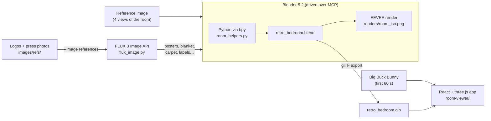
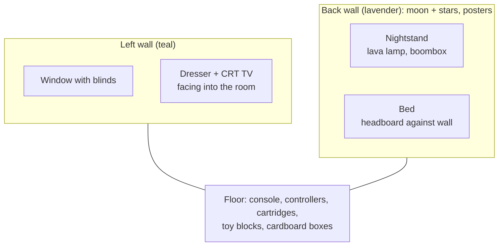
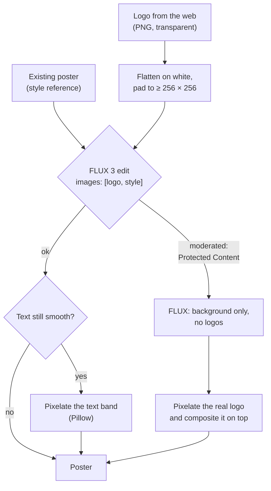
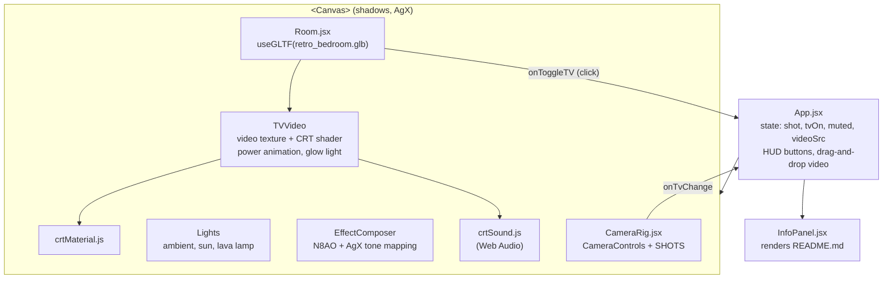
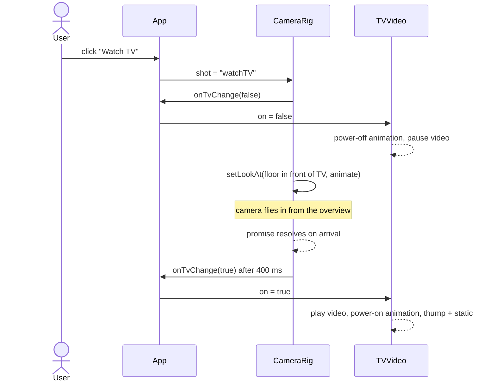
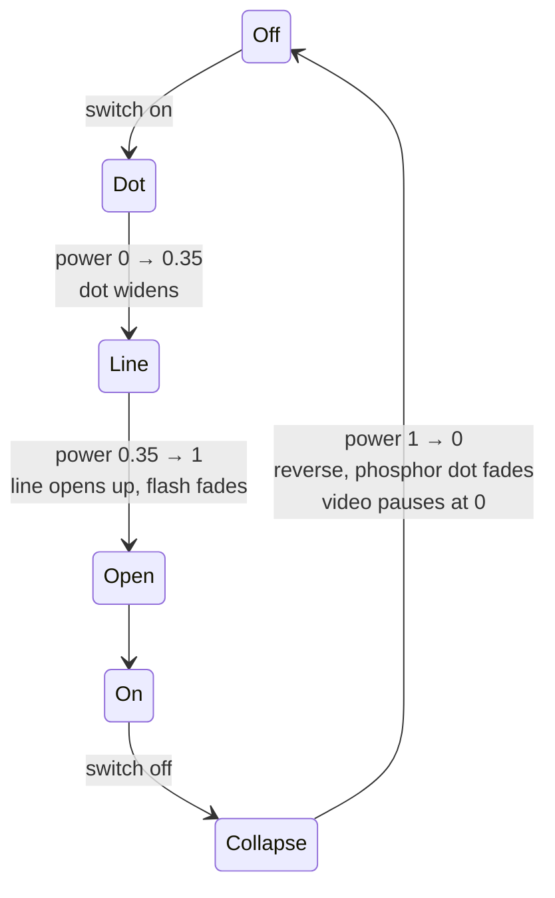

# Retro Bedroom

A cozy 90s gamer bedroom, rebuilt in Blender from a single AI-generated reference image, textured with images from FLUX, and shipped as an interactive React + three.js app. The CRT TV in the app plays a real video, switches on and off like a tube set, and the camera can fly in to watch it.


This README walks through how we got here, step by step.

## Contents

1. [The pipeline at a glance](#the-pipeline-at-a-glance)
2. [Step 1: the reference image](#step-1-the-reference-image)
3. [Step 2: building the room in Blender over MCP](#step-2-building-the-room-in-blender-over-mcp)
4. [Step 3: textures and posters with FLUX](#step-3-textures-and-posters-with-flux)
5. [Step 4: brand posters and the DGX Spark](#step-4-brand-posters-and-the-dgx-spark)
6. [Step 5: exporting to glTF](#step-5-exporting-to-gltf)
7. [Step 6: the React + three.js viewer](#step-6-the-react--threejs-viewer)
8. [Step 7: matching Blender's lighting](#step-7-matching-blenders-lighting)
9. [Step 8: the TV, camera shots and the CRT effect](#step-8-the-tv-camera-shots-and-the-crt-effect)
10. [Project layout](#project-layout)
11. [Running and regenerating](#running-and-regenerating)
12. [Credits](#credits)

## The pipeline at a glance



Everything was built from code: Claude Code drove the open Blender through the [MCP for Blender](https://github.com/ahujasid/blender-mcp) add-on (running `bpy` Python inside Blender and taking screenshots to check its work), called the FLUX API for images, and wrote the web app.

## Step 1: the reference image

The starting point was one generated image showing the same bedroom from four angles: top, front, side and isometric. It set the brief: a teal wall with a window, a lavender wall full of pixel-art posters and glow-in-the-dark stars, a CRT on a wooden dresser, a bed with a zigzag quilt, a lava lamp, and a floor covered in game cartridges, toy blocks and cardboard boxes.


Reading the four views together gave the floor plan:



## Step 2: building the room in Blender over MCP

The room is 4 × 4 m with 2.6 m walls, modelled entirely from simple primitives in a low-poly style. A small helper module, [`room_helpers.py`](room_helpers.py), gives every script the same building blocks (`box`, `plane`, `cyl`, `mat`, `img_mat`), so each step is a short Python snippet sent to Blender:

```python
exec(open("room_helpers.py").read())
wood = mat("Wood", (0.55, 0.3, 0.13), 0.6)
box("Dresser", 0.0, 0.55, 1.95, 3.35, 0.06, 0.85, wood, bevel=0.01)
```

The room went up in layers, checking a render after each one:


1. **Shell and light.** Floor slab, two walls (cream shell with a thin painted inner skin), a boolean cut for the window, venetian blinds, a warm low sun shining through the window and a dusky purple world.
2. **Furniture.** Dresser with drawers and knobs, CRT TV with a VCR, and the bed. The quilt is a subdivided box with jittered vertices and flat shading for the low-poly folds.
3. **Walls.** Six posters, a nightstand with a lava lamp (emissive blobs plus a point light) and a boombox, glow-in-the-dark stars and a crescent moon extruded from 2D outlines.
4. **Clutter.** A console with two controllers and Bézier cables, around 40 cartridges with pixel-art labels, toy blocks scattered by a seeded random placer that avoids the furniture, and four cardboard boxes (two open, with flaps and contents).

The final EEVEE render (AgX view transform, orthographic camera matching the reference's isometric angle):


## Step 3: textures and posters with FLUX

All artwork came from the [FLUX 3 Image](https://docs.bfl.ai/flux_3/flux3_image_overview) API through [`flux_image.py`](flux_image.py). Jobs ran in parallel (the account allows 8 at a time), each into its own folder under `images/room/`.


Two requests needed a second try: one hit the 8-job concurrency limit, and the first TV screen prompt was moderated as "Protected Content" for being too close to a famous platformer, so it was rewritten as an *original* 8-bit game. When the first quilt pattern came out too blue, it was regenerated with "mostly teal" in the prompt.

## Step 4: brand posters and the DGX Spark

Next came three brand posters (NVIDIA, Nebius, Black Forest Labs) and an NVIDIA DGX Spark on the dresser. `flux_image.py` gained an `--image` option so FLUX could edit from reference images. Each prompt passed the real logo plus one of the existing posters as a style reference, referred to in the prompt as `<ref_image_0>`, `<ref_image_1>`.



What happened with each:

- **Nebius** worked as a straight edit, using the wordmark and symbol as references.
- **Black Forest Labs** worked, but the wordmark came back as smooth text, so the bottom band was pixelated to match the rest.
- **NVIDIA** was moderated twice. FLUX painted only the background (a glowing chip and circuit traces), and the real logo and wordmark were pixelated and composited on top.
- The API rejects reference images smaller than 256 × 256 px, so the long, thin wordmarks were padded onto a white canvas first.


The **DGX Spark** is a beveled champagne box at 1.4× real size (150 × 150 × 50.5 mm), so it reads next to the CRT. Its front and back are a crop of the real metal-foam front from PNY's press photos. The TV also got a **power button with an LED** and **rabbit-ear antennas** (scaled down after a first version came out too big).


## Step 5: exporting to glTF

The scene is exported to `room-viewer/public/models/retro_bedroom.glb` (about 3.3 MB, JPEG textures). A few things had to change first, because glTF only understands UV-mapped image textures:

| Blender setup | Problem in glTF | Fix |
|---|---|---|
| Cardboard: box projection in object space | not supported | real UVs computed per face from object-space position |
| Cartridge labels: `Generated` coords + Mapping into a 4 × 3 label sheet | not supported | UVs set from the box's local coords; Mapping exported as `KHR_texture_transform` |
| Controller cables: Bézier curves | curves are not meshes | converted to meshes |
| Bevel and boolean modifiers | modifiers are not exported | `export_apply=True` |
| Lights | Blender watts don't map 1:1 | not exported; re-created in the app (see step 7) |

Object names are kept, so the app can find parts by name: `TVScreenImg`, `TVPowerLED`, `TVPowerButton`, `TVBody`.

## Step 6: the React + three.js viewer

`room-viewer/` is a Vite app using [React Three Fiber](https://r3f.docs.pmnd.rs/), [drei](https://drei.docs.pmnd.rs/) and [@react-three/postprocessing](https://react-postprocessing.docs.pmnd.rs/).



The TV plays `public/videos/big-buck-bunny.mp4` (the first 60 s of the Blender Foundation film, 640 × 360, 3.4 MB). To play something else:

- change `DEFAULT_VIDEO` in `src/App.jsx`,
- open the app with `?video=<url>` (the server must allow cross-origin loading), or
- drag a video file onto the page.

The video is cropped to the screen's 4:3 shape instead of being stretched.

## Step 7: matching Blender's lighting

The first web version used guessed lights and looked off. Instead of tuning by eye, the Blender values were ported with unit conversions, then the result was checked by sampling pixel colours against the Blender render.


| Light | Blender | three.js |
|---|---|---|
| World | colour (0.2, 0.18, 0.34), strength 0.6 | `ambientLight`, intensity 0.6·π (Blender radiance L gives albedo·L, three gives albedo·I/π) |
| Sun | 7 W/m², rotation (63°, 0°, −100°) | `directionalLight`, intensity 7, direction (0.877, −0.454, 0.155) |
| Lava lamp | 40 W point | `pointLight`, intensity 40 / 4π |
| TV glow | 25 W area light, 0.45 m | `rectAreaLight`, 25 / (0.45²·π), scaled by the screen's power |
| View transform | AgX | `ToneMapping` effect, AGX mode |

Three things closed the remaining gap:

- **Ambient occlusion.** N8AO stands in for EEVEE's raytraced AO and bounce light, darkening corners, wall joins and the area under the bed.
- **Unlit emitters.** The lava lamp, stars, moon and window pane are drawn with `MeshBasicMaterial` at their emission colour. As lit materials, the nearby point light blew them out to white.
- **Area light for the TV.** A point light 10 cm from the screen lit the bezel light grey. A forward-facing rect light behaves like Blender's area light.

Where the samples landed: ground, walls and floor are within a few RGB values of the Blender render.

## Step 8: the TV, camera shots and the CRT effect

### Camera shots

`CameraRig.jsx` uses drei's `CameraControls`. Its `setLookAt(…, true)` animates the move and returns a promise when the camera arrives, which is what lets the TV switch on at the right moment. Shots: **Overview** (fitted to the window), **Watch TV**, **Posters**, **DGX Spark**, **From bed** and **Orbit**.


The **Watch TV** shot runs as a sequence:



If another shot is chosen mid-flight, a run counter discards the stale promise so the TV doesn't switch on unexpectedly.

### This README, inside the app

The **i** button in the top-right corner opens this same `README.md` in a full-screen overlay above the scene, so GitHub and the app always show the same text. The text sits in a centred column, with a sticky table of contents on the side that is built from the headings and highlights the section you are reading. The README's own "Contents" list is dropped in the app, since the sidebar replaces it. `InfoPanel.jsx` imports the file with Vite's `?raw` suffix and renders it with `react-markdown` + `remark-gfm` (tables) + `rehype-slug` (heading anchors for the table of contents). Image paths like `docs/images/…` are mapped to bundled URLs with `import.meta.glob`, and `mermaid` code blocks are drawn with Mermaid (loaded only when the panel first opens), the same way GitHub draws them. Links to repo files become clickable once `REPO_URL` in `InfoPanel.jsx` is set.

### Switching on and off

Clicking the TV (or the HUD button) toggles it. The LED turns green or red right away, while a `power` value animates between 0 and 1: 0.75 s to switch on, 0.45 s to switch off. That value drives the shader and the TV's glow on the room.




### The CRT shader

`crtMaterial.js` replaces the screen's material with a `ShaderMaterial` that layers:

- barrel distortion (the bulging tube),
- the power collapse and the burning-hot thin beam,
- slight RGB fringing (chromatic aberration),
- extra contrast and saturation so AgX doesn't wash it out,
- 240 scanlines that fade out when too dense on screen (to avoid moiré),
- an aperture-grille RGB stripe mask,
- vignette, flicker and noise,
- a faint glass reflection when off.

With sound on, `crtSound.js` synthesizes the power sounds with Web Audio: a low thump and static when switching on, a falling zap when switching off.

## Project layout

```
.
├── README.md
├── flux_image.py            # FLUX 3 Image CLI (generate, or edit with --image)
├── room_helpers.py          # bpy helpers used by every Blender snippet
├── retro_bedroom.blend      # the Blender scene
├── renders/room_iso.png     # EEVEE render
├── images/
│   ├── room/<name>/         # generated textures and posters
│   └── refs/                # logos and DGX Spark press photos
├── docs/images/             # figures for this README
└── room-viewer/             # React + three.js app
    ├── public/models/retro_bedroom.glb
    ├── public/videos/big-buck-bunny.mp4
    └── src/
        ├── App.jsx          # state, HUD, lights, post-processing
        ├── Room.jsx         # model, TV click, LED, video + power animation
        ├── CameraRig.jsx    # camera shots and the Watch TV sequence
        ├── crtMaterial.js   # CRT shader
        ├── crtSound.js      # synthesized power sounds
        └── InfoPanel.jsx    # renders this README inside the app
```

## Running and regenerating

**The app**

```sh
cd room-viewer
npm install
npm run dev
```

**Images.** Set `BFL_API_KEY`, then:

```sh
# text to image
uv run flux_image.py "Retro pixel art poster, a green dragon…" \
  --aspect-ratio 3:4 --out images/room/poster_x

# edit from references (paths or URLs, up to 10)
uv run flux_image.py \
  "Pixel art poster in the style of <ref_image_1> with the logo from <ref_image_0>" \
  --image images/refs/logo.jpg --image images/room/poster_rocket/….png \
  --aspect-ratio 3:4 --out images/room/poster_y
```

**Model.** Edit the scene in Blender, then re-export with the same settings (run inside Blender):

```python
bpy.ops.export_scene.gltf(
    filepath="room-viewer/public/models/retro_bedroom.glb",
    export_format="GLB", export_apply=True, use_renderable=True,
    export_lights=False, export_cameras=False,
    export_image_format="JPEG", export_jpeg_quality=85,
)
```

## Credits

- **Big Buck Bunny** © Blender Foundation, [CC BY 3.0](https://creativecommons.org/licenses/by/3.0/), from [peach.blender.org](https://peach.blender.org/).
- **DGX Spark** product photos from the [PNY press image kit](https://www.pny.com/company/press-center/press-images/nvidia-dgx-spark).
- **Logos** from [Dashboard Icons](https://dashboardicons.com/) and [LobeHub Icons](https://lobehub.com/icons). NVIDIA, DGX Spark, Nebius and Black Forest Labs are trademarks of their respective owners and are used here for a personal, non-commercial scene.
- **Posters and textures** generated with [FLUX 3 Image](https://docs.bfl.ai/) by Black Forest Labs.
