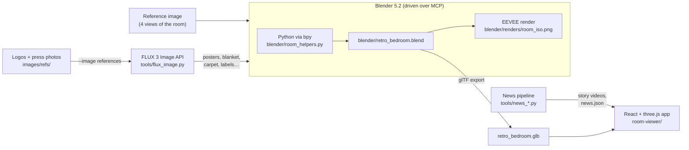
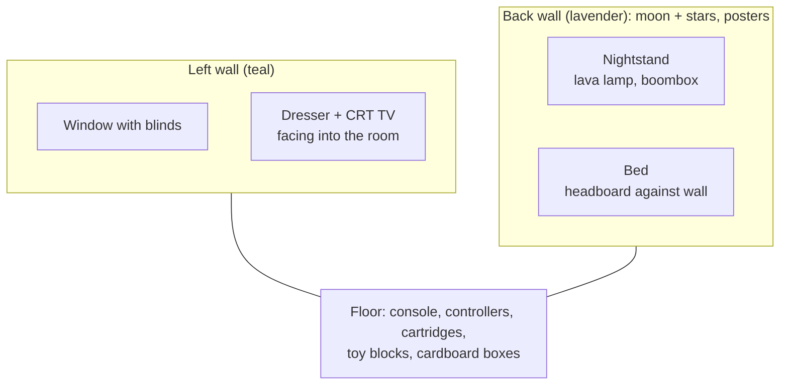
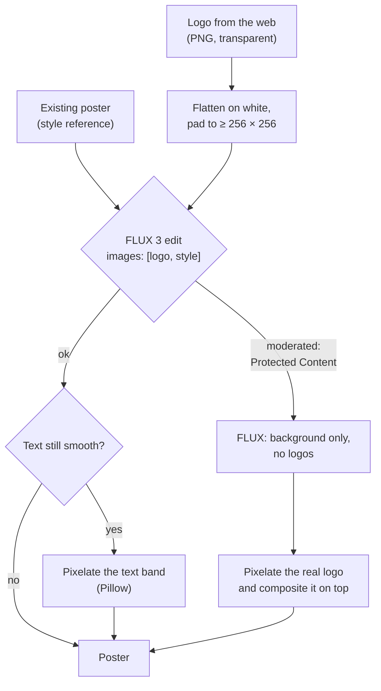
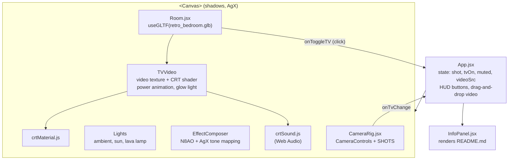
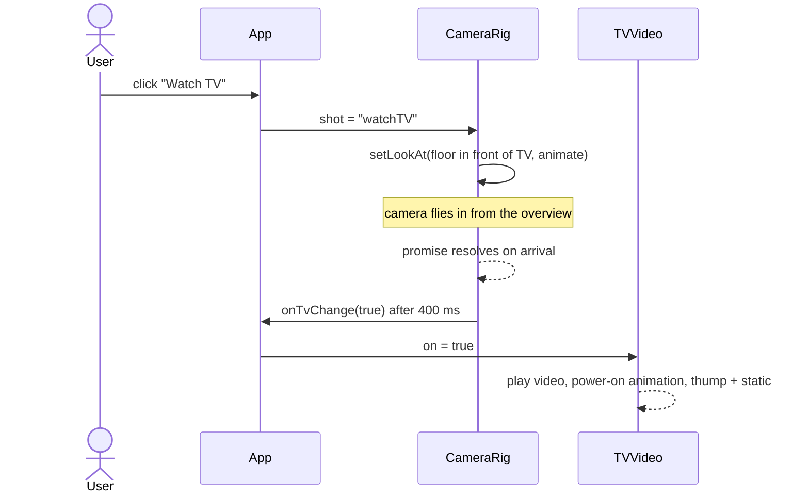
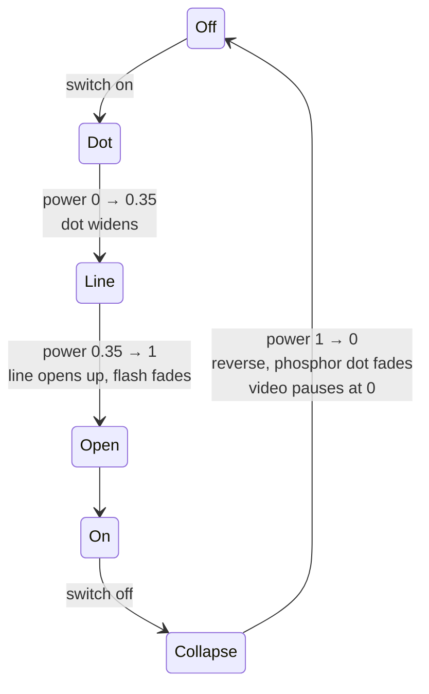
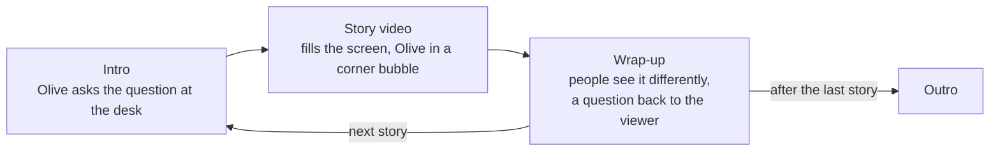
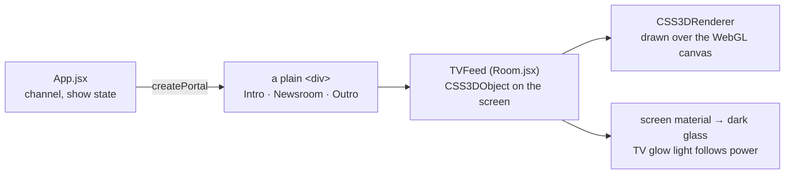
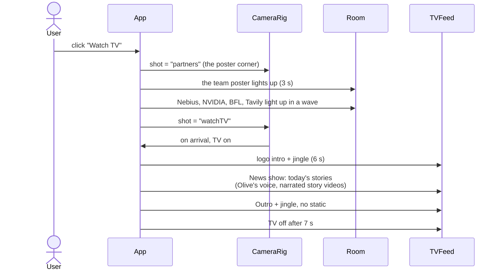

# Building the room and the show

The [README](../README.md) is about the news agent. This page keeps the full build log of everything around it: the bedroom, modelled in Blender by Claude Code over MCP and shown in the browser with React and three.js, and the labs where the logo, Olive and the show were made.

## The room at a glance



Everything was built from code: Claude Code drove the open Blender through the [MCP for Blender](https://github.com/ahujasid/blender-mcp) add-on (running `bpy` Python inside Blender and taking screenshots to check its work), called the FLUX API for images, and wrote the web app.

## Step 1: the reference image

The starting point was one generated image showing the same bedroom from four angles: top, front, side and isometric. It set the brief: a teal wall with a window, a lavender wall full of pixel-art posters and glow-in-the-dark stars, a CRT on a wooden dresser, a bed with a zigzag quilt, a lava lamp, and a floor covered in game cartridges, toy blocks and cardboard boxes.


Reading the four views together gave the floor plan:



## Step 2: building the room in Blender over MCP

The room is 4 × 4 m with 2.6 m walls, modelled entirely from simple primitives in a low-poly style. A small helper module, [`blender/room_helpers.py`](../blender/room_helpers.py), gives every script the same building blocks (`box`, `plane`, `cyl`, `mat`, `img_mat`), so each step is a short Python snippet sent to Blender:

```python
exec(open("blender/room_helpers.py").read())
wood = mat("Wood", (0.55, 0.3, 0.13), 0.6)
box("Dresser", 0.0, 0.55, 1.95, 3.35, 0.06, 0.85, wood, bevel=0.01)
```

The room went up in layers, checking a render after each one:


1. **Shell and light.** Floor slab, two walls (cream shell with a thin painted inner skin), a boolean cut for the window, venetian blinds, a warm low sun shining through the window and a dusky purple world.
2. **Furniture.** Dresser with drawers and knobs, CRT TV with a VCR, and the bed. The quilt is a subdivided box with jittered vertices and flat shading for the low-poly folds.
3. **Walls.** Six posters, a nightstand with a lava lamp (emissive blobs plus a point light) and a boombox, glow-in-the-dark stars and a crescent moon extruded from 2D outlines.
4. **Clutter.** A console with two controllers and Bézier cables, around 40 cartridges with pixel-art labels, toy blocks scattered by a seeded random placer that avoids the furniture, and four cardboard boxes (two open, with flaps and contents).

The final EEVEE render (AgX view transform, orthographic camera matching the reference's isometric angle):


## Step 3: textures and posters with FLUX

All artwork came from the [FLUX 3 Image](https://docs.bfl.ai/flux_3/flux3_image_overview) API through [`tools/flux_image.py`](../tools/flux_image.py). Jobs ran in parallel (the account allows 8 at a time), each into its own folder under `images/room/`.


Two requests needed a second try: one hit the 8-job concurrency limit, and the first TV screen prompt was moderated as "Protected Content" for being too close to a famous platformer, so it was rewritten as an *original* 8-bit game. When the first quilt pattern came out too blue, it was regenerated with "mostly teal" in the prompt.

## Step 4: brand posters and the DGX Spark

Next came three brand posters (NVIDIA, Nebius, Black Forest Labs) and an NVIDIA DGX Spark on the dresser. `flux_image.py` gained an `--image` option so FLUX could edit from reference images. Each prompt passed the real logo plus one of the existing posters as a style reference, referred to in the prompt as `<ref_image_0>`, `<ref_image_1>`.



What happened with each:

- **Nebius** worked as a straight edit, using the wordmark and symbol as references.
- **Black Forest Labs** worked, but the wordmark came back as smooth text, so the bottom band was pixelated to match the rest.
- **NVIDIA** was moderated twice. FLUX painted only the background (a glowing chip and circuit traces), and the real logo and wordmark were pixelated and composited on top.
- The API rejects reference images smaller than 256 × 256 px, so the long, thin wordmarks were padded onto a white canvas first.

Later, three more posters joined the partner corner:

- **Tavily** (the news agent's search engine) worked as a straight edit too: its arrow mark and wordmark from LobeHub Icons, flattened on white, plus the Nebius poster as the style reference. It hangs on the back wall after Black Forest Labs. Rocket and both Dragon posters moved right to make room, with the gaps evened out to 12 cm.
- **The team** replaced the "Game Heroes" poster next to Nebius: FLUX turned a photo of the three of us into waving 16-bit heroes, with "Game Heroes" as the style reference, under the title "Little Big Questions, the team". The photo itself isn't in the repository. The object is now `PosterTeam`.
- **NEMOTRON** was added under the NVIDIA wordmark, the same way the wordmark was: Pillow draws the word without antialiasing, scales it up 6× with nearest-neighbour so its blocks match the pixel size of the letters above, and composites it in NVIDIA green with a dark shadow (`images/room/poster_nvidia/nvidia_poster_nemotron.png`).


The **DGX Spark** is a beveled champagne box at 1.4× real size (150 × 150 × 50.5 mm), so it reads next to the CRT. Its front and back are a crop of the real metal-foam front from PNY's press photos. The TV also got a **power button with an LED** and **rabbit-ear antennas** (scaled down after a first version came out too big).


## Step 5: exporting to glTF

The scene is exported to `room-viewer/public/models/retro_bedroom.glb` (about 3.3 MB, JPEG textures). A few things had to change first, because glTF only understands UV-mapped image textures:

| Blender setup | Problem in glTF | Fix |
|---|---|---|
| Cardboard: box projection in object space | not supported | real UVs computed per face from object-space position |
| Cartridge labels: `Generated` coords + Mapping into a 4 × 3 label sheet | not supported | UVs set from the box's local coords; Mapping exported as `KHR_texture_transform` |
| Controller cables: Bézier curves | curves are not meshes | converted to meshes |
| Bevel and boolean modifiers | modifiers are not exported | `export_apply=True` |
| Lights | Blender watts don't map 1:1 | not exported; re-created in the app (see step 7) |

Object names are kept, so the app can find parts by name: `TVScreenImg`, `TVPowerLED`, `TVPowerButton`, `TVBody`.

## Step 6: the React + three.js viewer

`room-viewer/` is a Vite app using [React Three Fiber](https://r3f.docs.pmnd.rs/), [drei](https://drei.docs.pmnd.rs/) and [@react-three/postprocessing](https://react-postprocessing.docs.pmnd.rs/).



The Video channel plays a video of your own:

- open the app with `?video=<url>` (the server must allow cross-origin loading), or
- drag a video file onto the page.

The video is cropped to the screen's 4:3 shape instead of being stretched.

## Step 7: matching Blender's lighting

The first web version used guessed lights and looked off. Instead of tuning by eye, the Blender values were ported with unit conversions, then the result was checked by sampling pixel colours against the Blender render.


| Light | Blender | three.js |
|---|---|---|
| World | colour (0.2, 0.18, 0.34), strength 0.6 | `ambientLight`, intensity 0.6·π (Blender radiance L gives albedo·L, three gives albedo·I/π) |
| Sun | 7 W/m², rotation (63°, 0°, −100°) | `directionalLight`, intensity 7, direction (0.877, −0.454, 0.155) |
| Lava lamp | 40 W point | `pointLight`, intensity 40 / 4π |
| TV glow | 25 W area light, 0.45 m | `rectAreaLight`, 25 / (0.45²·π), scaled by the screen's power |
| View transform | AgX | `ToneMapping` effect, AGX mode |

Three things closed the remaining gap:

- **Ambient occlusion.** N8AO stands in for EEVEE's raytraced AO and bounce light, darkening corners, wall joins and the area under the bed.
- **Unlit emitters.** The lava lamp, stars, moon and window pane are drawn with `MeshBasicMaterial` at their emission colour. As lit materials, the nearby point light blew them out to white.
- **Area light for the TV.** A point light 10 cm from the screen lit the bezel light grey. A forward-facing rect light behaves like Blender's area light.

Where the samples landed: ground, walls and floor are within a few RGB values of the Blender render.

## Step 8: the TV, camera shots and the CRT effect

### Camera shots

`CameraRig.jsx` uses drei's `CameraControls`. Its `setLookAt(…, true)` animates the move and returns a promise when the camera arrives, which is what lets the TV switch on at the right moment. Shots: **Overview** (fitted to the window), **Watch TV**, **Posters**, **DGX Spark** and **From bed**.


The **Watch TV** shot runs as a sequence:



If another shot is chosen mid-flight, a run counter discards the stale promise so the TV doesn't switch on unexpectedly. The first version also switched the set off when the move started, which made a TV that was already on flicker off and back on; now the shot only switches it on. Since [step 12](#step-12-the-show-on-the-bedroom-tv), Watch TV also turns the sound on, lights up the posters and opens the Little Big Questions programme.

### This README, inside the app

The **i** button in the top-right corner opens this same `README.md` in a full-screen overlay above the scene, so GitHub and the app always show the same text. The text sits in a centred column, with a sticky table of contents on the side that is built from the headings and highlights the section you are reading. The README's own "Contents" list is dropped in the app, since the sidebar replaces it. `InfoPanel.jsx` imports the file with Vite's `?raw` suffix and renders it with `react-markdown` + `remark-gfm` (tables) + `rehype-raw` (the README's HTML tables, used for image grids) + `rehype-slug` (heading anchors for the table of contents). Image paths like `docs/images/…` and `bfl-challenge/…` are mapped to bundled URLs with `import.meta.glob`, and `mermaid` code blocks are drawn with Mermaid (loaded only when the panel first opens), the same way GitHub draws them. Links to repo files become clickable once `REPO_URL` in `InfoPanel.jsx` is set.

### Switching on and off

Clicking the TV (or the power button in the TV panel) toggles it. The app opens with the set off. The LED turns green or red right away, while a `power` value animates between 0 and 1: 0.75 s to switch on, 0.45 s to switch off. That value drives the shader and the TV's glow on the room.




### The CRT shader

`crtMaterial.js` replaces the screen's material with a `ShaderMaterial` that layers:

- barrel distortion (the bulging tube),
- the power collapse and the burning-hot thin beam,
- slight RGB fringing (chromatic aberration),
- extra contrast and saturation so AgX doesn't wash it out,
- 240 scanlines that fade out when too dense on screen (to avoid moiré),
- an aperture-grille RGB stripe mask,
- vignette, flicker and noise,
- a faint glass reflection when off.

With sound on, `crtSound.js` synthesizes the power sounds with Web Audio: a low thump and static when switching on, a falling zap when switching off.

## Step 9: Little Big Questions and the labs

`/labs` is a page of small experiments for the show, each one an entry that leads to its own page. There are two so far, **Logo** and **Presenter**. Adding one is a page component plus a row in `EXPERIMENTS` in `src/labs/Labs.jsx`.

There is no router library: `main.jsx` looks at the path and lazy-loads either the bedroom or the labs, so the labs pages don't download three.js and the bedroom doesn't download the labs.

Every experiment starts with FLUX concepts next to things built in code. The prompts live in one file, `labs_prompts/prompts.tsv` (`<experiment>/<id>`, aspect ratio, prompt), and `labs_prompts/generate.sh` runs them through `flux_image.py`, six at a time, into `room-viewer/src/labs/assets/<experiment>/<id>/`. The pages pick the images up with `import.meta.glob`, show each with its prompt, and keep older versions when a prompt is run again. The first batch was 16 images: six logo directions, and four presenter characters, each as a character sheet and at a news desk, plus an empty studio plate and the show on a 90s CRT.


## Step 10: the logo, the intro and the outro

The strongest FLUX direction was a coral question mark whose dot is a smiling Earth. It was redrawn as SVG (`src/labs/brand.jsx`) so it scales and animates: the globe's continents are a strip that slides behind a circular clip, which reads as the planet turning, and its eyes blink.

**The intro** is a five-second news-programme opener in pure CSS animation, timed with delays: the camera starts tight on the globe and pulls back, an orbit ring draws around it, the question mark draws itself, "BIG" slams in with a flash and a shake, "Questions" hops in letter by letter, and the tagline fades up. **The outro** closes the show with the same background: "That's all for today!", the stacked logo, "Keep asking little big questions", and Olive peeking up from the corner to wave. Both come in three looks (Studio, Daylight, Pixel CRT) and replay by remounting with a new React key. Both play a four-second orchestral jingle, which ends just as the intro's tagline lands.

**Lockups.** One `<Lockup>` component draws the four layouts the show needs (stacked, horizontal, one line, mark only) in four tones (colour, reversed on navy, one colour, white), all scaled from a single size. The Logo page also shows clear space, the smallest sizes (below 32 px the globe drops its face and stops turning), and the logo in use: a corner bug over video in any corner, a lower third, an end card, a thumbnail, a browser tab and avatars, and stickers.


## Step 11: Olive, the presenter

Of the four FLUX presenters, **Olive the owl** was the one coded: an SVG character (`src/labs/Olive.jsx`) who blinks, bobs, moves her beak while talking, glances at the story screen, and changes expression with the story. Hard topics such as war get softer brows lifted in the middle and a small head tilt, concerned and never frightened. While explaining, she raises a wing towards the screen.

She is drawn for desk framing. The first version was a full owl behind a desk, and it broke in several places: the desk only hid her bottom tenth, so her belly showed as an egg-shaped second face, one wing was hidden behind her body, and her hands hung below the desk line. The redraw ends exactly at the desk's front edge, with her wing tips resting on it. Olive and the desk now sit in one anchored box so they always move together, her speech bubble points at her beak, and the question banner moved to the right so it no longer covers the desk logo.


**The show** (`src/labs/show.jsx`) is a rundown of stories, each a single question: today's news from `src/labs/news.json` (written by `news_publish.py`), or the evergreen stories in `src/labs/stories.json` when there is no news. Every story runs three segments; a story without its own video skips the video:



Everything inside the studio is sized in container units, so the same set works at 16:9 on the labs page and at 4:3 on the TV.

**Her voice.** `tools/presenter_voice.py` voices each intro and wrap-up line with [Chatterbox](https://github.com/resemble-ai/chatterbox) running locally, cloning the sample clip of a Fish Audio voice ("kids"). The sample's link is signed for an hour, so the script fetches a fresh one from the Fish Audio API on every run. It writes one wav per line to `public/voices/olive/` and records each line's text and length in `src/labs/olive-voice.json`. A line is redone only when its text changes, and a line edited after it was recorded stays silent until it is voiced again. On a Mac's CPU each line takes 20 to 80 seconds.

During playback the bubble text follows the audio and the beak moves while it plays. If the browser blocks audio, the line types out at speaking pace instead. One bug is worth recording: React StrictMode starts each effect twice in development, so the first attempt to play was aborted, and its fallback started a typing timer that was never stopped. That stale timer kept writing the previous line into the bubble, which flickered empty several times a second. Now nothing from a cancelled line can touch the bubble.

## Step 12: the show on the bedroom TV

The labs pages play live on the bedroom's CRT: the intro, the show and the outro are real React DOM laid onto the screen in 3D, not a video or a texture.



`App` renders the current programme into a plain `<div>` through a React portal. `TVFeed` measures the screen mesh, places that `<div>` on the glass as a `CSS3DObject`, and draws it with three's `CSS3DRenderer`, which re-applies a CSS 3D transform every frame so the page stays glued to the screen as the camera moves. The screen's own material becomes dark glass, so the tube shows black when the picture collapses.

Two dead ends came first. drei's `<Html transform>` mounted an empty box, because it creates a second React root inside the three.js renderer and React 19 StrictMode unmounted it mid-render. And the first `CSS3DObject` version vanished whenever the channel changed, because StrictMode's test unmount removed it from the scene and it was only ever added once.

Since the picture is HTML rather than a texture, the CRT shader can't reach it, so the CRT look is redone in CSS (`.tv-feed` in `styles.css`): scanlines, glass glare, darker curved edges, a slight flicker, the dot → line → picture power animation, and a burst of static on every channel change except the outro, which cuts in clean. The trade-off is that the page always draws on top of the 3D scene, which is fine for the current camera shots.

**The TV panel** (top right, `src/TVControls.jsx`) is the remote control. It's a debugging tool, so it only shows when the URL has `?debug`, and its keys only work then:

| Control | What it does | Key |
|---|---|---|
| Power, Sound | switch the set on or off, and mute or unmute, each labelled with its state | |
| Watch TV | fly to the TV and start the programme | |
| Video · Logo intro · News show · Outro | change channel | `1`–`4` |
| Look, Replay | pick the intro and outro look, and replay them with the jingle | `R` |
| Story, Segment | jump to any story or segment | |
| Prev, Running, Next | step through the show, or pause and resume it | `←` `→` space |
| Posters | light up the team and partner posters, without going on to the TV | |

`?channel=logo`, `?channel=show` or `?channel=outro` opens the app on that channel. Without one it opens on the logo. The Video channel plays a video passed with `?video=<url>` or dropped on the page.

**Watch TV** now opens the whole programme, starting with the posters of the people who made it:



The intro waits until the set is actually on, so it isn't missed during the camera move. Picking another channel or shot at any point cancels the rest of the sequence.

**The posters light up** in `Room.jsx`: each one's image doubles as its emission, so it brightens with its own colours, and its paper backing glows warm yellow and grows a little more than the poster, which draws a glowing border even around the dark ones. Each starts 250 ms after the one before and stays lit for 700 ms, so they overlap in a wave. The materials are cloned once per mesh: React StrictMode runs the setup twice in development, and a second clone left the animation driving materials that were no longer on screen. The "partners" shot frames the corner where the five posters hang and has no button of its own.

**The show ends.** After the last story's wrap-up the outro plays, Olive waves goodbye, and the set switches itself off 7 seconds later. Picking the Outro channel by hand leaves the set on.


## Regenerating the room's assets

**Images.** Set `BFL_API_KEY`, then:

```sh
# text to image
uv run tools/flux_image.py "Retro pixel art poster, a green dragon…" \
  --aspect-ratio 3:4 --out images/room/poster_x

# edit from references (paths or URLs, up to 10)
uv run tools/flux_image.py \
  "Pixel art poster in the style of <ref_image_1> with the logo from <ref_image_0>" \
  --image images/refs/logo.jpg --image images/room/poster_rocket/….png \
  --aspect-ratio 3:4 --out images/room/poster_y
```

**Labs concepts.** Add or edit a line in `labs_prompts/prompts.tsv`, then run the whole list, or only the ids that match a filter:

```sh
bash labs_prompts/generate.sh                    # everything
bash labs_prompts/generate.sh presenter/owl      # one experiment or concept
```

**Model.** Edit `blender/retro_bedroom.blend`, then re-export with the same settings (run inside Blender; `//` is the folder of the `.blend`):

```python
bpy.ops.export_scene.gltf(
    filepath=bpy.path.abspath("//../room-viewer/public/models/retro_bedroom.glb"),
    export_format="GLB", export_apply=True, use_renderable=True,
    export_lights=False, export_cameras=False,
    export_image_format="JPEG", export_jpeg_quality=85,
)
```
